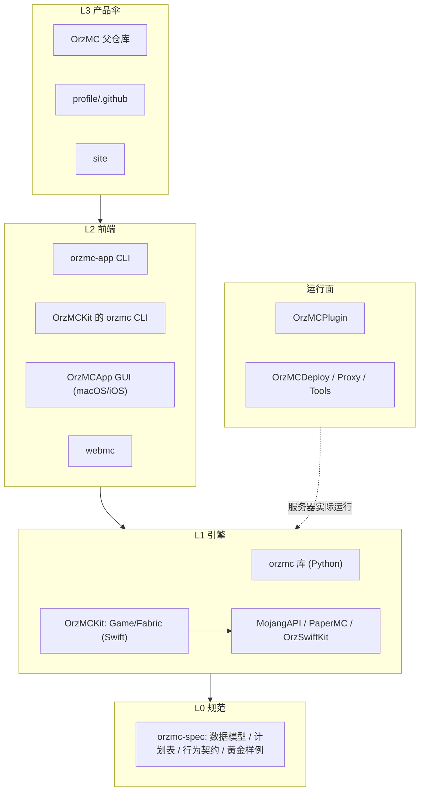

# OrzMC 产品架构（产品伞）

> **状态**：现行 ｜ **最后更新**：2026-10-13
> **读者**：产品/架构维护者、子模块协作者、AI 智能体。
> **定位**：定义 OrzMC 的**分层、各层所有权、允许的依赖方向与禁止事项**。
> **配套**：进行中的落地计划见 [`product-unification-plan.md`](product-unification-plan.md)；
> 协作规则见根 [`AGENTS.md`](../AGENTS.md)；当前状态见根 [`HANDOFF.md`](../HANDOFF.md)。

---

## 1. 定义与产品形态

### 1.1 一句话定义

OrzMC 是一个围绕 **PaperMC 生态**的 Minecraft 社区服务器开源组织，对外是**一个产品**
（玩家能连、能玩、能管理的私服体验），对内是**一组可独立发布的仓库**：
一套**语言无关规范** + 多套**核心实现** + 多个**产品面** + 服务器**运行面** + **产品伞**。

### 1.2 工具产品形态（目标）：一个 `orzmc`，两个面，一套核心

- **一个产品 `orzmc`**，对外暴露两个**产品面（surface）**：

  | 面 | 形态 | 说明 |
  |---|---|---|
  | **CLI** | 命令行 `orzmc` | 可**独立安装**（脚本 / PATH），无 GUI 也能完成全部核心操作 |
  | **GUI** | `OrzMCApp` | macOS / iOS 图形应用 |

- **互相安装 / 打开**（产品要求）：
  - CLI → GUI：`orzmc app install` / `orzmc app open`（安装并打开图形应用）。
  - GUI → CLI：GUI 内提供「安装命令行工具」入口（把 `orzmc` 装入 PATH）。
- **共用核心逻辑**：
  - **同一平台内**：CLI 与 GUI 链接**同一份核心** —— Apple 平台用 `OrzMCKit`；
    非 Apple 平台 CLI 用 Python `orzmc` 库。
  - **跨语言**：通过 [`docs/spec`](spec/README.md) 契约 + conformance 套件保证行为一致。
- **允许差异化功能，但主体核心逻辑统一**：各面可有特有交互（GUI 专属视图、CLI 专属脚本化输出），
  但**版本解析、下载、校验、Java 托管、启动/部署**等核心行为必须一致。
- **一个 CLI 面**：Swift CLI 与 Python CLI 是**同一工具的不同实现**，命令 / 参数 / 输出契约统一，
  用户看到的始终是**一个 `orzmc`**（契约见 `docs/spec`，待建）。

---

## 2. 产品全景（仓库角色地图）

| 仓库 | 层 | 角色 | 语言/栈 | 发布物 |
|---|---|---|---|---|
| `OrzMC/OrzMC`（本父仓库） | L3 产品伞 | 锁定组合、品牌、文档、版本列车 | Git submodule | 组合快照 |
| `OrzMC/.github` (`profile`) | L3 产品伞 | 组织主页 / 生态图 | Markdown | GitHub profile |
| `OrzMC/OrzMCSite` | L3 产品伞 | 官方网站 | Hugo | GitHub Pages |
| `OrzMC/OrzPythonMC` | L1 引擎 + L2 前端 | Python 引擎（库 `orzmc`）+ CLI（`orzmc-app`） | Python / uv | PyPI 双包 + 6 平台二进制 |
| `OrzMC/OrzMCKit` | L1 引擎 + L2 前端 | Swift 引擎（`Game`/`Fabric`）+ CLI（`orzmc` 可执行） | Swift | SwiftPM 库 + 可执行 |
| `OrzMC/OrzMCApp` | L2 前端 | macOS/iOS 图形启动器 | SwiftUI | Developer ID / App |
| `OrzMC/OrzWebMC` | L2 前端 | 浏览器连服实验 | 前端 | — |
| `OrzMC/MojangAPI` | L1 引擎依赖 | Mojang 元数据（清单/version JSON/assets） | Swift | SwiftPM 包（组织） |
| `OrzMC/PaperMC` | L1 引擎依赖 | Paper 下载/Hangar API | Swift | SwiftPM 包（组织） |
| `OrzGeeker/OrzSwiftKit` | L1 引擎依赖 | `JokerKits` / `Utils` 基础设施 | Swift | SwiftPM 包（外部） |
| `OrzMC/OrzMCPlugin` | 运行面 | PaperMC 核心插件 | Java 25 / Gradle | Hangar / Modrinth |
| `OrzMC/OrzMCDeploy` | 运行面 | Docker Compose 部署平台 | Shell / Compose | Release tarball |
| `OrzMC/OrzMCProxy` | 运行面 | FRP 跨运营商中转 | Shell / frp | 脚本 |
| `OrzMC/OrzMCBackup`、`rust-thanos`、`tools/*` | 运行面 | 世界优化备份、游戏内插件 | Kotlin/Rust/PHP/Java | 各自发布 |

> **治理警示**：Swift 引擎的**部分依赖在个人仓库**（`wangzhizhou/*`、`OrzGeeker/*`），
> 不在 `OrzMC` 组织下。这是当前治理最薄弱的一环（见第 7 章）。

---

## 3. 分层模型



### L0 规范（`orzmc-spec`，待建）

- **内容**：数据模型、归一化中间表示（计划表）、行为契约、版本号、黄金样例。
- **语言无关**：JSON Schema / Markdown + JSON 样例，不绑定任何实现语言。
- **地位**：引擎的**契约来源**；前端不直接依赖它（只依赖引擎公共 API）。

### L1 引擎（两个实现，同一契约）

- **职责**：把"要装哪个版本、什么类型、跑在哪"解析成**纯数据的计划**，再执行下载/校验/组装/启动。
- **两个实现**：
  - Python：`orzmc` 库（`OrzPythonMC`），分层 `domain / infra / core / services`。
  - Swift：`OrzMCKit`（`Game` / `Fabric`）+ 依赖包（`MojangAPI` / `PaperMC` / `OrzSwiftKit`）。
- **要求**：两者**输入/输出符合 L0 契约**；内部实现可不同。跨语言一致性由 conformance 套件保证（计划 Phase 2）。

### L2 产品面（CLI / GUI，独立发布）

- **职责**：只做交互与编排，**只调用所属核心的公共 API**，不触碰核心内部实现。
- **两个面**：CLI（`orzmc`）与 GUI（`OrzMCApp`）；CLI 有 Python / Swift 两个实现，
  共同收敛为**一个命令契约**（同一工具的不同实现）。
- **同平台共核**：Apple 平台的 CLI 与 GUI 共用 `OrzMCKit`；非 Apple 平台 CLI 用 Python `orzmc` 库。
- **跨面集成**：CLI ↔ GUI 的安装 / 打开 / 更新能力（见 §1.2）是**产品要求**，
  需在 `docs/spec` 中定义接口与安装记录格式（与 Python 现有 `install.conf` 对齐）。

### L3 产品伞

- **职责**：品牌、文档索引、**版本列车**（一次产品组合对应哪些子件版本）、跨仓协调。
- **不负责**：任何业务代码。

### 运行面（不属于工具链，但同属产品）

`OrzMCPlugin`（服务器核心插件）、`OrzMCDeploy`（部署）、`OrzMCProxy`（中转）、
`OrzMCBackup` / `rust-thanos` / `tools/*`（运维与游戏内插件）。
它们与工具链的关系是：**工具链负责把服务器/客户端跑起来**，运行面负责**跑起来之后**。

---

## 4. 引擎六阶段与现有实现映射

统一抽象（L0 契约的核心）：

```
resolve  →  plan  →  download  →  verify  →  assemble  →  launch
元数据      计划表     下载         校验        组装         启动/托管
```

| 阶段 | Python（`orzmc`） | Swift（`OrzMCKit`） |
|---|---|---|
| resolve | `core/mojang.py` / `core/fabric.py` / `core/forge.py` | `MojangAPI` + `Fabric` 包 |
| plan | `core/{client,server}/*` provider + `domain/paths.py` | `Client+Download.generateDownloadItemInfos()`、`Server/Deploy/{Vanilla,Paper}` |
| download | `services/downloader.py` + `infra/transfer.py` | `DownloadAPI`（PaperMC 包） |
| verify | `infra/hashing.py` + provider 内 sha1 | `DownloadItemInfo(hash:hashType:.sha1)` |
| assemble | `domain/launch.py`、`services/client.py` | `Client+Boot.parseBootArgs()`、`Server+Launch.launchServer()` |
| launch | `infra/runner.py`、`services/server.py` | `Game/Utils/GameUtils`、`Shell` |

> **接缝**：每个阶段都应能被单独调用（二次开发），输入/输出为 L0 定义的纯数据。

---

## 5. 允许的依赖方向（强制）

**只允许向下，禁止向上或平级跨内部。**

```
L2 前端(A) ──▶ L1 引擎(A 的公共 API)
L1 引擎   ──▶ L0 规范
L3 产品伞 ──▶ 只做锁定与文档，不改任何实现代码
```

| 允许 | 说明 |
|---|---|
| 前端 → **本语言引擎的公共 API** | 如 `orzmc_app` 只 `from orzmc import ...`；App 只用 `Game`/`MojangAPI` 公共类型 |
| 引擎 → L0 规范 | 引擎是规范的**实现者** |
| 引擎 → 第三方/平台库 | 通过自身 infra 层封装（HTTP/FS/进程） |
| 运行面 ↔ 引擎/前端 | 仅通过**进程边界 / 网络 API / 文件**交互，不共享源码 |

| 禁止 | 原因 |
|---|---|
| ❌ 前端 import 引擎**内部**模块 | 破坏封装，引擎重构会连锁破坏前端 |
| ❌ 引擎 import 前端 | 依赖倒置 |
| ❌ 引擎跨语言互相依赖 | 两种语言不能互相 import；只能通过 L0 契约对齐 |
| ❌ L0 规范依赖任何实现 | 规范必须可脱离实现独立演进 |
| ❌ 一个前端依赖另一个前端的内部 | 前端之间只共享 L0/L1，不共享 UI/编排 |

---

## 6. 禁止事项（anti-patterns）

- ❌ **在父仓库提交任何子项目代码**——父仓库只 bump 指针（见 `AGENTS.md` 铁律 1）。
- ❌ **把某语言的实现当作"标准"**——标准只在 `orzmc-spec`；实现只是实现。
- ❌ **为统一而合并语言栈不同的仓库**——工具链/CI/签名/平台矩阵不兼容（计划 D1）。
- ❌ **让前端绕过引擎公共 API 直接算计划/下载**——计划生成必须收敛在引擎。
- ❌ **在运行面（plugin/deploy）里重复实现工具链逻辑**——需要的能力应沉到引擎或 spec。
- ❌ **静默漂移**：改了引擎的行为契约却不更新 `orzmc-spec` / conformance 样例。

---

## 7. 所有权与治理

| 资产 | 归属 | 决策权 |
|---|---|---|
| L0 规范 `docs/spec/`（现行）/ 未来 `orzmc-spec` | 父仓库 `OrzMC/OrzMC` | 组织 |
| Python 核心 + CLI | `OrzMC/OrzPythonMC` | 组织 |
| Swift 可复用基础组件（`Game`/`Fabric`）+ `orzmc` CLI | `OrzMC/OrzMCKit` | 组织 |
| Swift 引擎依赖 | `OrzMC/MojangAPI`、`OrzMC/PaperMC`、`OrzMC/ExarotonAPI`、`OrzGeeker/OrzSwiftKit`、`OrzGeeker/OrzAppUpdater` | 组织 / 外部（均维护者自有） |
| GUI | `OrzMC/OrzMCApp` | 组织 |
| 运行面 | 各 `OrzMC/*` 子模块 | 各自仓库 |
| 产品伞 | 父仓库 `OrzMC/OrzMC` | 组织 |

**近期治理动作（见计划 D5 / Q3 / Q4）**：
1. ☑ 已把 `OrzMCKit` 登记为父仓库子模块（`08e6b76`，消除"编外引擎"）。
2. 已把 Swift 相关仓库统一收拢到 `swift/`：`swift/app` + `swift/lib/{OrzMCKit,MojangAPI,PaperMC,ExarotonAPI,OrzSwiftKit,OrzAppUpdater}`（均登记为父仓库子模块，伞内锁指针）；`OrzGeeker/*` 为维护者自有外部组织。
   > ⚠️ 与 D11（外部 Swift 依赖 HEAD 制）有张力：伞内现在也钉组织自有 / OrzGeeker 的 Swift 依赖版本。
   > 开发态用 **SwiftPM 本地覆盖**指向 `swift/lib/*`（不提交）；正式构建仍以远端引用为准。
3. 明确各前端 CLI 的分工（Python `orzmc` vs Swift `orzmc`），避免用户认知混乱。

### 7.1 依赖引用规范（Swift / SwiftPM）

- **规范路径**：OrzMC 自有仓库一律用**当前路径**引用，禁用会重定向的旧路径（重定向会反复引发误读，
  且 `raw.githubusercontent.com` 不保证跟随仓库改名）：

  | 规范路径 | 旧路径（已重定向） |
  |:--|:--|
  | `OrzMC/MojangAPI` | `wangzhizhou/MojangAPI` |
  | `OrzMC/PaperMC` | `wangzhizhou/PaperMC` |
  | `OrzMC/ExarotonAPI` | `wangzhizhou/ExarotonAPI` |
  | `OrzMC/OrzMCKit` | `OrzGeeker/OrzMCKit` |
  | `OrzMC/OrzMCApp` | `OrzGeeker/OrzMCApp`（含 `SUFeedURL`） |

  外部仓库（`OrzGeeker/OrzSwiftKit`、`OrzGeeker/OrzAppUpdater`）保持原路径；若日后转组织，同步更新。
- **本地覆盖远端（开发态）**：父仓库已把 Swift 相关仓库以子模块检出到 `swift/lib/*`（引擎 `swift/lib/OrzMCKit`）。
  可用 **SwiftPM 本地编辑**或 **Xcode 本地包**覆盖同名远端依赖，从而用伞内本地源码开发：
  - SwiftPM（OrzMCKit 自身及其依赖）：`scripts/swift-dev.sh edit`（`unedit` 还原；见脚本头说明）；
  - app（Xcode）：`scripts/swift-dev.sh xcode` 打印手动步骤（*Add Local Package* → `swift/lib/OrzMCKit`）。
- ⚠️ **本地覆盖不提交**：`app` 的发布/文档 CI（`release-app.yml` / `publish-docs.yml`）只检出 app 仓库本身，
  提交本地路径依赖（`project.pbxproj` / `Package.resolved`）会**打断独立构建**。开发时覆盖、验证后还原；
  正式版仍以规范路径的 SwiftPM 版本为准。
- **版本策略（Q7 已决：HEAD 制）**：伞内引擎版本 = `OrzMCKit` 的 `main` HEAD。父仓库子模块与 `app` 的
  SwiftPM 依赖（`branch = main`）都跟随 HEAD、保持同步，**不再依赖 tag**（为快速迭代）。
- **依赖仓库均可直接改**：`OrzMC/*` 与 `OrzGeeker/*` 的 SwiftPM 依赖均属维护者自有；必要时可拉到本地修改，
  以**清晰的模块能力划分 + 跨模块配合**为目标（见 [`AGENTS.md` §7.1](../AGENTS.md)）。

---

## 8. 已知差异（spec 必须统一或显式声明的点）

> 这些是"同一件事、两边不同做法"的实例，是 `orzmc-spec` 与 conformance 的直接输入。

| 维度 | Python | Swift | 处理方向 |
|---|---|---|---|
| 根目录布局 | `~/minecraft/versions/<v>/{client,server/<type>}`、`java/<major>`、`cache/`、`backup/` | `~/minecraft/manifest/<v>/client/<type>/...` | spec 定义唯一规范布局；**一次性对齐、不做迁移**（旧目录提示删除重建） |
| 支持的客户端类型 | vanilla / fabric / forge | vanilla / fabric | 在 spec 声明能力矩阵，未支持者显式 SKIP |
| 支持的服务器类型 | vanilla / paper / fabric / forge | vanilla / paper | 同上 |
| Java 运行时 | 应用托管 JRE 到 `java/<major>/` | 依赖系统/外部 Java（`OracleJava`） | spec 定义 Java 需求与获取策略 |
| 进度模型 | 计数任务 / 字节任务双协议 | 进度回调（`progressHandler`） | spec 定义归一化进度事件 |
| 缓存策略 | 元数据 TTL 24h + refresh | 无统一缓存层 | spec 定义缓存与刷新语义 |

---

## 9. 版本与发布边界

- **各仓库独立版本号**（不强制统一）：
  - Python：`orzmc` / `orzmc-app` PyPI 版本（release-please）。
  - Swift：`OrzMCKit` SwiftPM 版本；App 走签名 + appcast。
  - 运行面：plugin（Hangar/Modrinth）、deploy（Release tarball）等各自节奏。
- **产品版本列车**：父仓库（未来的 `RELEASES.md`）记录"一次产品组合 = 哪些子件版本"。
- **规范版本**：`orzmc-spec` 自带 `specVersion`，与实现解耦；破坏性变更升 major。

---

## 10. 与运行面的关系

- 工具链（L0–L2）负责**把客户端/服务端在任意机器上跑起来**（本地或通过部署）。
- 运行面负责**服务器跑起来之后的能力**：插件（`OrzMCPlugin`）、部署编排（`OrzMCDeploy`）、
  跨网接入（`OrzMCProxy`）、世界优化（`OrzMCBackup`/`rust-thanos`）。
- 二者通过**约定与产物**衔接：如 `OrzMCDeploy` 管理 PaperMC 实例，插件由 `OrzMCPlugin` 提供；
  工具链部署的目录布局应与运行面的期望一致（spec 布局的又一约束来源）。

---

## 11. 术语表

| 术语 | 含义 |
|---|---|
| **产品伞** | 父仓库 + 组织主页 + 官网，负责统一产品对外呈现与组合锁定 |
| **引擎** | 把"版本/类型/平台"解析为计划并执行的库（Python `orzmc` / Swift `OrzMCKit`） |
| **前端** | 面向用户的交互层（CLI / GUI / Web） |
| **计划表** | 引擎 `plan` 阶段的纯数据输出（下载项 / 启动参数 / 服务端计划） |
| **六阶段** | `resolve → plan → download → verify → assemble → launch` |
| **规范（L0）** | 语言无关的 `orzmc-spec`：数据模型 + 行为契约 + 黄金样例 |
| **conformance 套件** | 跨语言跑同一批黄金样例、比对计划表的测试 |
| **版本列车** | 一次产品组合对应的各子件版本清单 |

---

## 12. 演进路径

本文件是计划 Phase 0 的交付物。后续按
[`product-unification-plan.md`](product-unification-plan.md) 推进：

1. **Phase 0**（本文件）：冻结分层、所有权、依赖方向与禁止事项。
2. **Phase 1**：建 `orzmc-spec`，抽数据模型与中间表示。
3. **Phase 2**：黄金样例 + 跨语言 conformance。
4. **Phase 3**：引擎对齐，消除第 8 章差异。
5. **Phase 4**：前端组件化与二次开发指南。
6. **Phase 5**：统一产品发布列车（`RELEASES.md`）。

> **产品形态目标见 §1.2**：一个 `orzmc`、CLI 与 GUI 两面、共用核心逻辑、可互相安装/打开。

> 本文档随架构演进更新；每次架构改动（分层/依赖/所有权变化）都应在此追加说明，
> 并同步 `AGENTS.md` 与 `HANDOFF.md`。

---

## 13. 变更记录

| 日期 | 变更 |
|---|---|
| 2026-10-13 | 初版：仓库角色地图、L0–L3 分层、引擎六阶段映射、允许依赖方向、禁止事项、治理 |
| 2026-10-13 | 新增 §1.2 **产品形态**（一个 `orzmc`、CLI+GUI 两面、共核、互相安装/打开）；L2 改称「产品面」；治理表重定位 `OrzMCKit` 为 Swift 可复用基础组件 |
| 2026-10-13 | **Q4 已决**：`OrzMCKit` 登记为父仓库子模块（`08e6b76`）；Swift 引擎依赖 `MojangAPI`/`PaperMC` 已入组织，`OrzSwiftKit` 维持外部 |
